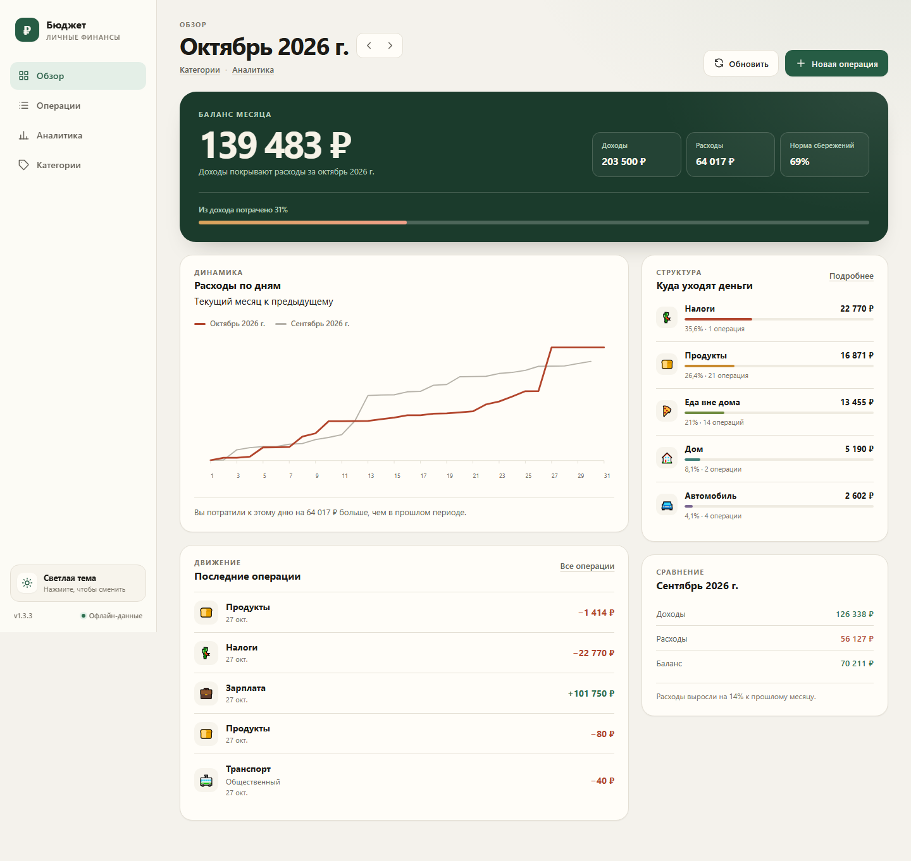
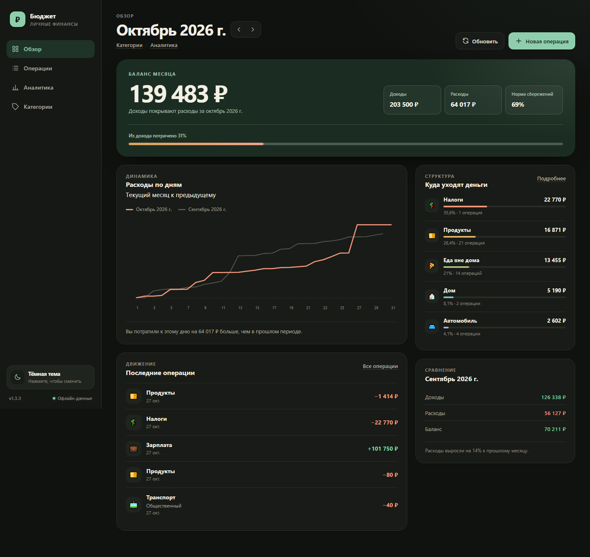
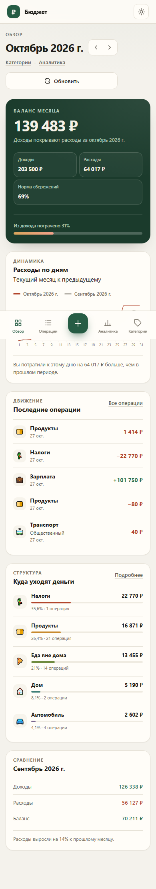
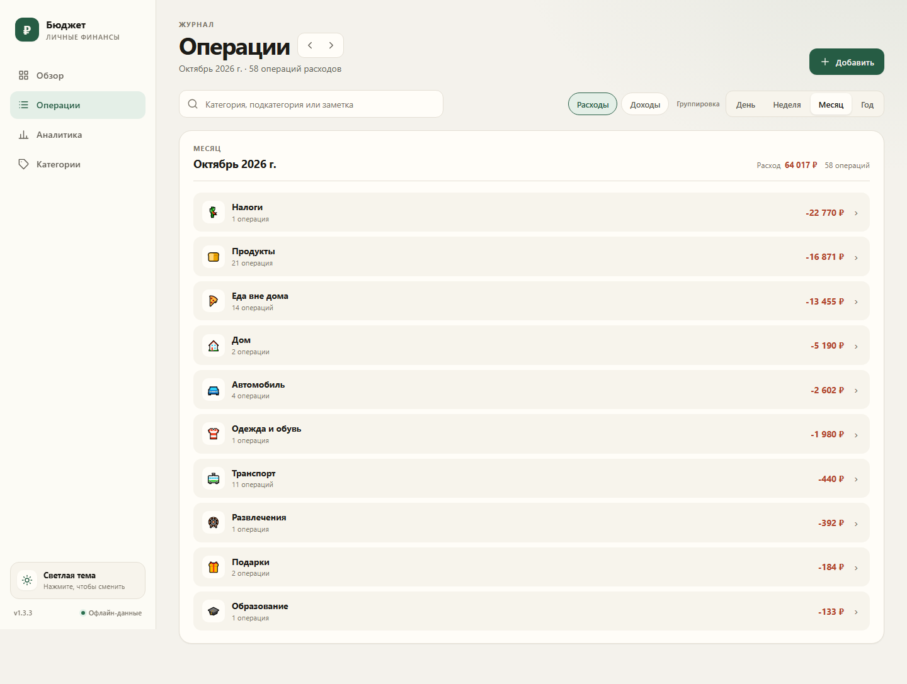
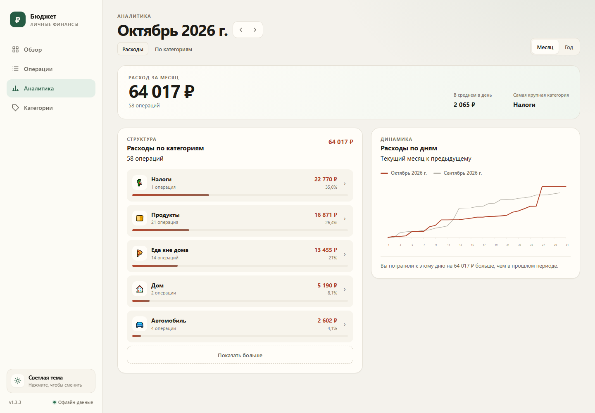
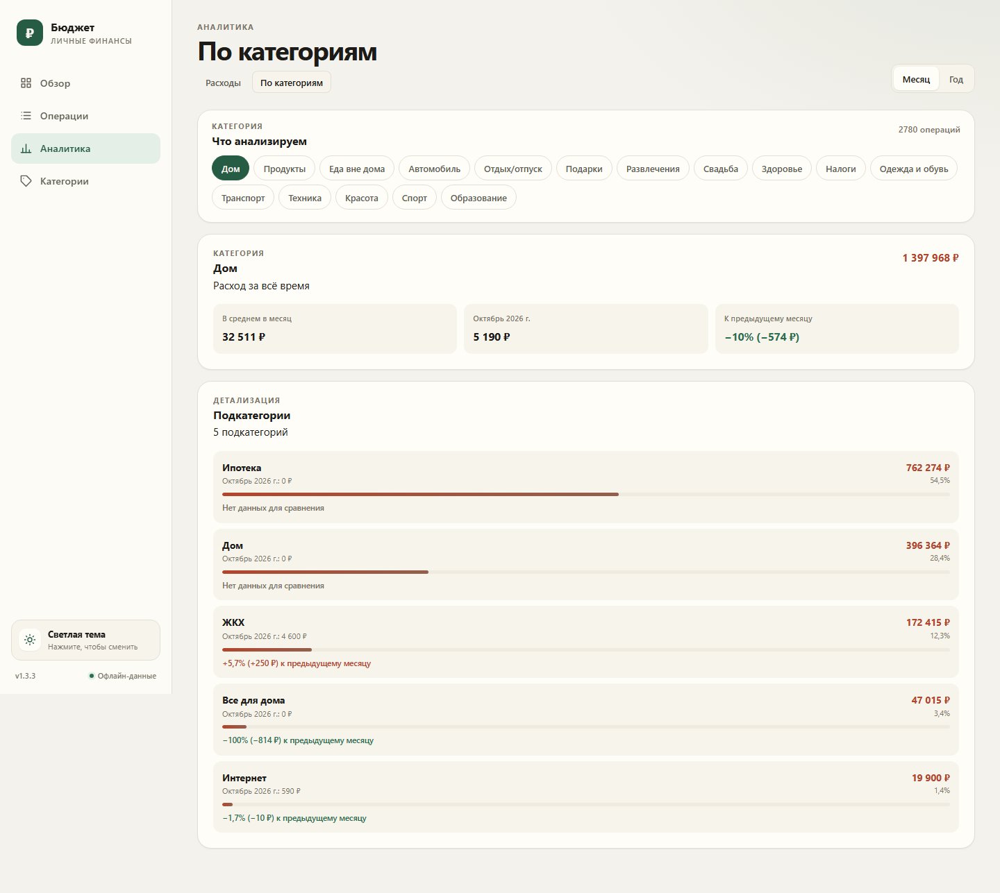
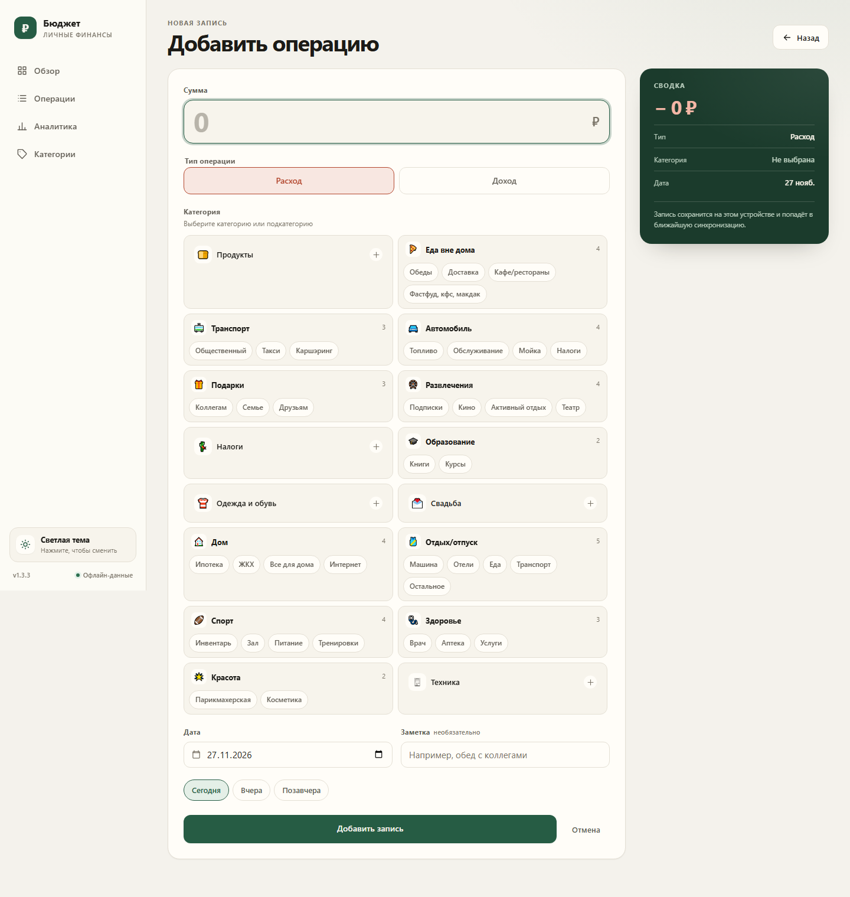
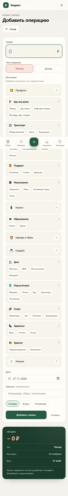
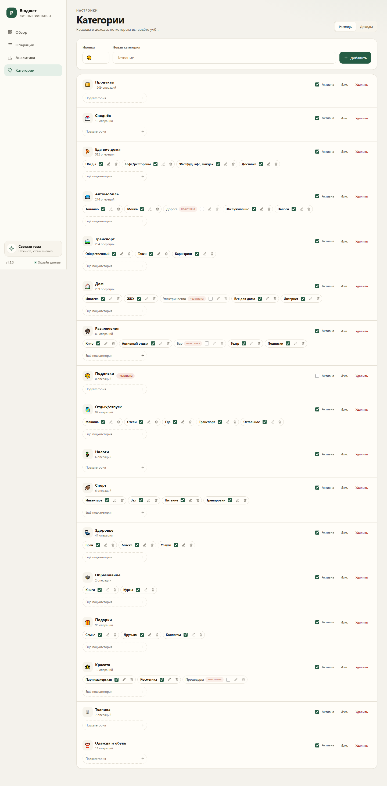
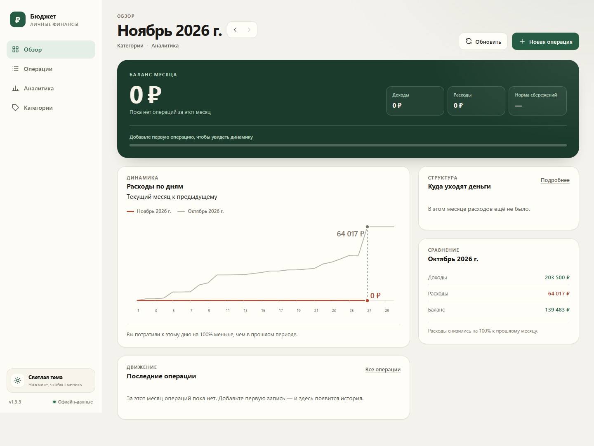

# Редизайн «Бюджета»: тихий гроссбух

Ветка: `redesign/quiet-ledger`. Ничего не пушилось.

Цель была не «перекрасить», а пересобрать интерфейс вокруг того, зачем человек открывает приложение: **понять, сколько осталось, куда ушли деньги и что записать дальше**. Ниже — наблюдения, принципы и решения. Скриншоты — в конце.

## Что не работало в старом интерфейсе

- **Не было постоянной навигации.** «Категории» и «Аналитика» жили ссылками в шапке, а главным действием выглядела огромная кнопка «Обновить».
- **Главный экран отвечал не на главный вопрос.** Карточка «Расход» занимала почти всю ширину, доход и баланс были разнесены, а при пустом месяце экран выглядел сломанным: `0 ₽`, гигантская пустота и «Обновить».
- **Добавление упиралось в список.** Категории были раскрыты в длинный список, форма растягивалась на несколько экранов, на телефоне сумма, категория и дата оказывались далеко друг от друга.
- **«Операции» игнорировали месяц.** Страница показывала всю историю — на демо-данных это ~9 300 px, 12+ карточек подряд, без поиска.
- **Две аналитики не складывались в один раздел.** «Расходы» и «По категориям» дублировали итоги и не имели общей навигации.
- **Визуально всё было фиолетовым стеклом.** Градиенты, blur, радиусы 8 px и карточки в карточках создавали шум; светлой темы не было вовсе.

## Принципы

1. **Один экран — один ответ.** Обзор отвечает «как месяц?», журнал — «что было?», аналитика — «почему?», форма — «что записать?».
2. **Месяц — единица контекста.** Месяц сохраняется в URL и переходит между разделами; журнал и аналитика не теряют его.
3. **Сначала данные, потом декор.** Цифры крупные, метки мелкие, декор не конкурирует с суммой.
4. **Один акцент.** Тёмно-зелёный — действие и «всё хорошо»; терракота — расход; больше цветов в интерфейсе нет, кроме палитры категорий в графике.
5. **Прогрессивное раскрытие.** Сначала категория и сумма, детали — по клику. В форме — сетка категорий вместо простыни.
6. **Пустое состояние — приглашение,** а не дырка: у каждого пустого блока есть объяснение и следующий шаг.
7. **Тема и доступность — часть продукта,** а не настройка для избранных.

## Информационная архитектура

| Раздел | Маршрут | Вопрос пользователя |
| --- | --- | --- |
| Обзор | `/` | «Как прошёл месяц и что дальше?» |
| Операции | `/operations` | «Что я записывал?» |
| Аналитика → Расходы | `/expense-analytics` | «Куда ушли деньги?» |
| Аналитика → По категориям | `/category-analytics` | «Как менялась эта категория?» |
| Категории | `/categories` | «Как устроен мой справочник?» |
| Новая запись | `/add` | «Записать операцию» |

- **Десктоп:** фиксированный сайдбар 248 px, контент до 1220 px.
- **Телефон:** верхняя панель с брендом и темой + нижний таб-бар на 5 слотов с центральной кнопкой «+». Кнопка добавления всегда в зоне большого пальца.
- **Планшет:** тот же таб-бар; сетки перестраиваются в одну колонку.

## Визуальный язык

### Палитра

| Токен | Светлая | Тёмная | Роль |
| --- | --- | --- | --- |
| `--bg` | `#f4f2ec` | `#101210` | тёплая бумага / глубокий графит |
| `--surface` | `#fffdf8` | `#181b17` | карточки |
| `--text` | `#1c1b17` | `#f1eee4` | основной текст |
| `--text-secondary` | `#615d54` | `#b0ab9f` | подписи |
| `--text-tertiary` | `#7a7468` | `#928d83` | метаданные |
| `--accent` | `#265c44` | `#8fceac` | действие, активная навигация |
| `--expense` | `#b2452c` | `#f1957a` | расход |
| `--income` | `#2c6f4f` | `#7cd3a4` | доход |
| `--hero-bg` | `#1b3b2c` | `#1b2d22` | «выписка» месяца |

Категории в структуре расходов получают пять дополнительных цветов (`--chart-1…5`), чтобы полосы различались без легенды.

### Типографика

- Системный стек: SF Pro / Segoe UI Variable / Segoe UI / Roboto — без внешних шрифтов, приложение остаётся офлайн-первым.
- Крупные суммы: 650 вес, трекинг −0.04…−0.05 em, `font-variant-numeric: tabular-nums`.
- Микро-лейблы: 10–11 px, uppercase, трекинг 0.12 em.
- Всё остальное — 13–15 px. Иерархия держится на размере и цвете, а не на весе.

### Форма

- Радиусы: 10 px контролы, 14 px чипы/поля, 20 px карточки, 26 px «выписка».
- Тени только на крупных поверхностях (`--shadow-sm`, `--shadow-md`); на светлой теме они почти незаметны.
- Границы — `1px` тёплого оттенка, без «стеклянных» обводок.
- Иконки — собственный inline-SVG набор (штрих 1.8), эмодзи категорий берутся из данных и работают как цветные маркеры.

### Компоненты

- **Карточка** — единая поверхность с заголовком-«eyebrow», заголовком и действием справа.
- **Сегмент-контрол** — для месяца/года и группировки.
- **Чип** — для категорий и быстрых дат.
- **Выписка** (receipt) — тёмная карточка-сводка в форме: сумма, тип, категория, дата, заметка. Даёт уверенность перед сохранением.
- **Пустое состояние** — текст + следующий шаг, без иллюстраций-заглушек.

## Экраны

### Обзор

1. **Шапка:** «Обзор», месяц с переключателем, тихие ссылки «Категории» и «Аналитика», синхронизация и «Новая операция».
2. **Выписка месяца:** баланс крупно, доходы/расходы/норма сбережений тремя плитками, полоса «из дохода потрачено».
3. **Динамика:** текущий месяц к предыдущему, с подсказками у линии и коротким выводом.
4. **Куда уходят деньги:** топ-5 категорий с эмодзи, долей и суммой.
5. **Последние операции:** 5 записей за выбранный месяц.
6. **Сравнение:** итоги прошлого месяца и изменение расходов.

Порядок на телефоне: выписка → динамика → последние операции → структура → сравнение.

### Операции

- Месяц/год — в шапке; журнал ограничен выбранным месяцем (для «Года» — выбранным годом).
- Поиск по категории, подкатегории и заметке.
- Тип (расходы/доходы) и группировка (день/неделя/месяц/год) — отдельными контролами.
- Категории раскрываются по клику; для одной подкатегории операции видны сразу.
- Действия появляются при наведении на десктопе и всегда доступны на телефоне.

### Новая запись

- Крупное поле суммы без спиннеров, с символом валюты.
- Расход/доход — сегмент с цветовой семантикой.
- Категории — сетка карточек с эмодзи; подкатегории — чипами внутри карточки.
- Дата и заметка — в одной строке; быстрые «Сегодня / Вчера / Позавчера».
- Справа — «выписка», которая собирается по мере заполнения; на телефоне она уезжает под форму.
- Кнопка сохранения внизу, ошибки — рядом с полями.

### Аналитика

- Общие табы «Расходы» и «По категориям».
- **Расходы:** итог за месяц/год, среднее в день/месяц, крупнейшая категория, разбивка по категориям с раскрытием подкатегорий и операций, график динамики; для года — гистограмма по месяцам.
- **По категориям:** горизонтальный выбор категории, итог за всё время, среднее, последний месяц и изменение; ниже — подкатегории с долями и сравнением. Если базы для сравнения нет, честно написано «Нет данных для сравнения».

### Категории

- Переключатель «Расходы / Доходы».
- Форма добавления: иконка, название, кнопка.
- Каждая категория — строка с иконкой, количеством операций, чекбоксом активности, «Изм.» и «Удалить».
- Подкатегории — компактные чипы: имя, чекбокс активности, иконки редактирования/удаления. Добавление — маленькое поле-«пилюля» под чипами.
- Тип категории блокируется, если к ней привязаны операции; подсказка объясняет почему.

## Поведение, тема и доступность

- **Тема:** светлая и тёмная, по умолчанию — системная; переключатель в сайдбаре/верхней панели, выбор сохраняется в `localStorage`. Инлайн-скрипт в `index.html` ставит тему до первой отрисовки, чтобы не было вспышки.
- **Фокус:** видимое кольцо `:focus-visible`, все интерактивные элементы — не меньше 32–44 px.
- **Контраст:** tertiary-текст затемнён до читаемого на мелких подписях; цвет не единственный носитель смысла (расход/доход подписаны).
- **Движение:** 150–160 ms, только `transform/opacity`; `prefers-reduced-motion` отключает анимации.
- **Пустота и ошибки:** «Нет операций», «Ничего не нашлось», «Нет связи с сервером» — с человеческим следующим шагом.
- **Адаптив:** брейкпоинты 1180 / 980 / 720 / 480. Проверены 24 комбинации «страница × ширина» (390, 768, 1024, 1440) — горизонтального скролла нет.

## Что за рамками этого редизайна

- Бюджеты по категориям (поля `budgetSum`/`budgetPeriod` в данных есть, UI пока нет).
- Счета и цели: в данных есть `Account` и `Target`, но это отдельный продуктовый сценарий.
- Переводы между счетами, теги, регулярные операции.
- Ось Y и подписи делений у графиков, виртуализация длинного журнала.
- Код-сплиттинг: `default.json` (1.5 MB) всё ещё попадает в основной бандл; на производительность первого запуска это влияет, на дизайн — нет.

## Проверка

- `pnpm test` — 173 теста, 27 файлов, всё зелёное.
- `pnpm type-check` — без ошибок.
- `pnpm lint` — без ошибок и предупреждений.
- `pnpm build` — production-сборка собирается, PWA-иконки перегенерированы в новой палитре.
- Ручная проверка: светлая/тёмная тема, переключение месяца, поиск, раскрытие категорий, форма добавления, мобильный таб-бар.

## Скриншоты

> Демо-данные заканчиваются октябрём 2026, поэтому в ссылках используется `?month=2026-10`. Ноябрь 2026 — честное пустое состояние.

### Обзор, светлая тема

### Обзор, тёмная тема

### Обзор на телефоне

### Операции и аналитика

### Новая запись

### Категории

### Пустой месяц

